# Lịch đăng Facebook 7 ngày – Tuyến viral “Tip & Trick edit video CapCut”

**Thời gian:** Thứ 7, 17/10 → Thứ 6, 23/10/2026 · **2 bài/ngày** · mỗi bài dưới 300 chữ
**Mục tiêu:** tăng nhận diện, tiếp cận, lưu bài và chia sẻ. **Không bán hàng.**
**Dấu ấn thương hiệu lặp lại:** series `#MỗiNgày1TrickCapCut` + câu chốt “Lưu lại để dùng dần”.
**Ảnh:** thư mục `images/`, kích thước 1080×1350 (tỉ lệ 4:5, hiển thị to nhất trên bảng tin Facebook).

> Lưu ý: tên menu CapCut có thể khác đôi chút giữa các phiên bản và giữa tiếng Việt/tiếng Anh. Trước khi đăng, nên mở app kiểm tra lại các bước một lần.

## Tổng quan lịch đăng

| Ngày | Giờ | Bài | Chủ đề | Đòn bẩy viral |
|---|---|---|---|---|
| T7 17/10 | 11:30 | 1 | Phụ đề tự động | Thực dụng → lưu bài |
| T7 17/10 | 20:00 | 2 | 5 lỗi “nhìn là biết làm vội” | Đồng cảm + tự nhận lỗi → bình luận |
| CN 18/10 | 11:30 | 3 | Keyframe zoom ảnh tĩnh | Thực dụng → lưu bài |
| CN 18/10 | 20:00 | 4 | Edit bằng điện thoại hay máy tính? | Tranh luận 2 phe → bình luận |
| T2 19/10 | 11:30 | 5 | Cắt video khớp nhạc tự động | Thực dụng |
| T2 19/10 | 20:00 | 6 | Video tặng 20/10 trong 10 phút | Thời sự (20/10) + cảm xúc → tag, chia sẻ |
| T3 20/10 | 09:00 | 7 | Lời chúc 20/10 hiện từng chữ | Thời sự + cảm xúc |
| T3 20/10 | 20:00 | 8 | Phân thân 2 người trong 1 khung | Bất ngờ, “wow” → chia sẻ |
| T4 21/10 | 11:30 | 9 | Slow-motion bằng đường cong tốc độ | Thực dụng |
| T4 21/10 | 20:00 | 10 | Video viral không cần máy quay xịn | Phá niềm tin cũ → tranh luận |
| T5 22/10 | 11:30 | 11 | Xóa phông không cần phông xanh | Bất ngờ + thực dụng |
| T5 22/10 | 20:00 | 12 | Dừng hình giới thiệu nhân vật (đón Halloween) | Hài hước → tag bạn bè |
| T6 23/10 | 11:30 | 13 | Âm thanh sạch | Thực dụng |
| T6 23/10 | 20:00 | 14 | Tổng kết + thử thách + bình chọn chủ đề tuần sau | Cộng đồng → bình luận |

---

## NGÀY 1 – Thứ 7, 17/10

### Bài 1 · 11:30 · Phụ đề tự động
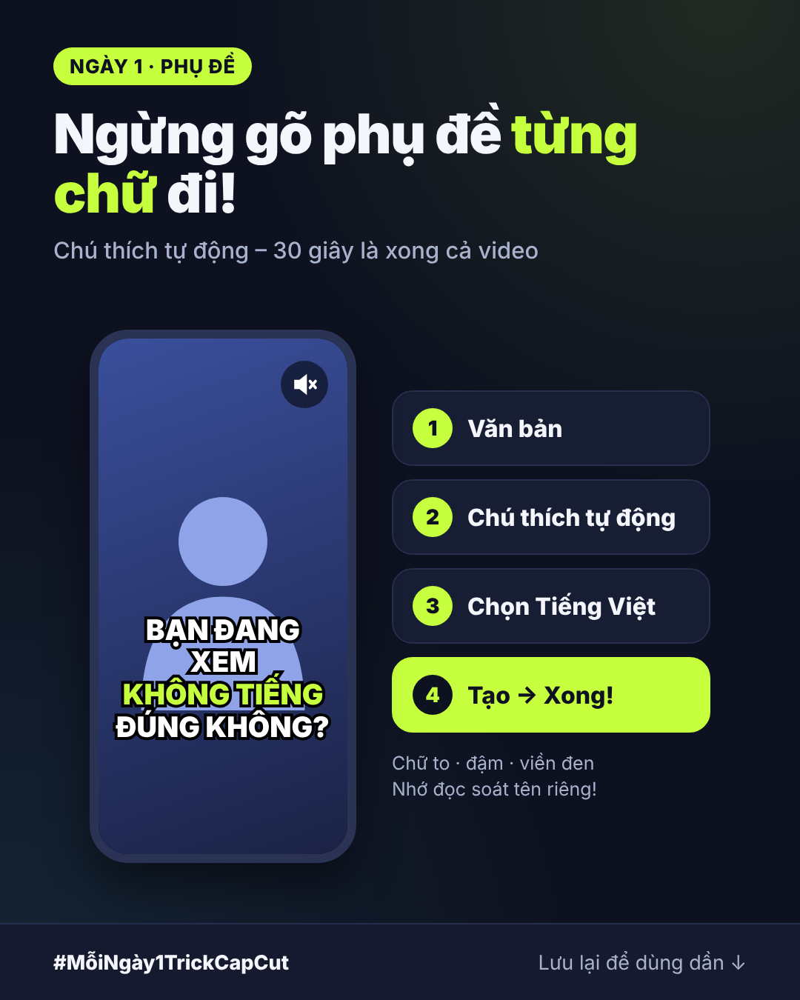

Bạn vẫn đang gõ phụ đề TỪNG CHỮ MỘT? Dừng lại ngay 🛑

Rất nhiều người lướt Facebook ở chế độ tắt tiếng: trên xe buýt, trong giờ làm, lúc nằm cạnh người đang ngủ… Video không có phụ đề gần như bị lướt qua.

CapCut làm việc này trong vòng 30 giây:

1️⃣ Mở dự án → chạm **Văn bản (Text)**
2️⃣ Chọn **Chú thích tự động (Auto captions)**
3️⃣ Chọn ngôn ngữ **Tiếng Việt** → **Tạo**
4️⃣ Đợi vài giây, phụ đề tự khớp với lời nói

Mẹo để phụ đề trông “xịn” hơn:
✅ Chữ to, đậm, có viền đen: đọc được trên mọi nền
✅ Đặt ở khoảng 1/3 dưới màn hình, đừng sát mép (dễ bị nút Like, Comment che mất)
✅ Chỉnh kiểu cho 1 dòng rồi áp dụng cho tất cả
✅ Đọc soát lại một lượt: AI vẫn hay nhầm tên riêng và từ địa phương

Bạn đã dùng tính năng này chưa? Comment **“CÓ”** hoặc **“CHƯA”** nhé 👇

📌 Lưu lại để dùng dần. Mỗi ngày một trick mới!
#MỗiNgày1TrickCapCut #CapCut #EditVideo #MẹoCapCut

---

### Bài 2 · 20:00 · 5 lỗi “nhìn là biết làm vội”
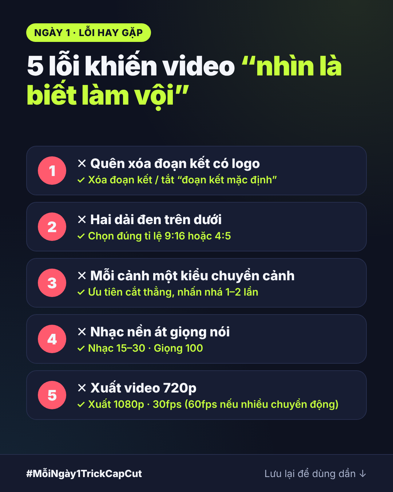

5 lỗi khiến video của bạn “nhìn là biết làm vội” 😅 (số 1 gần như ai cũng từng dính)

❌ **1. Quên xóa đoạn kết có logo CapCut**
→ Chạm vào đoạn kết trên dòng thời gian và xóa. Hoặc vào Cài đặt, tắt “Thêm đoạn kết mặc định” để khỏi lặp lại.

❌ **2. Video có 2 dải đen trên dưới**
→ Chọn đúng **Tỉ lệ** ngay từ đầu: 9:16 cho Reels, 4:5 cho bảng tin. Phần trống thì dùng **Canvas → Làm mờ**.

❌ **3. Mỗi cảnh một kiểu chuyển cảnh xoay, lật**
→ Video chuyên nghiệp chủ yếu dùng cắt thẳng. Chuyển cảnh chỉ để nhấn nhá 1–2 lần.

❌ **4. Nhạc nền át giọng nói**
→ Giảm âm lượng nhạc xuống khoảng 15–30 (mặc định là 100). Người xem cần nghe rõ bạn nói gì.

❌ **5. Xuất video 720p**
→ Xuất **1080p, 30fps**. Cảnh chuyển động nhiều thì chọn 60fps.

Thú thật đi: bạn từng mắc lỗi số mấy? Mình thì dính lỗi số 1 cả chục lần rồi 🙈 Comment con số của bạn nhé!

📌 Lưu lại, kiểm tra trước mỗi lần xuất video.
#MỗiNgày1TrickCapCut #CapCut #EditVideo #LỗiEditVideo

---

## NGÀY 2 – Chủ nhật, 18/10

### Bài 3 · 11:30 · Keyframe: biến ảnh tĩnh thành video có hồn
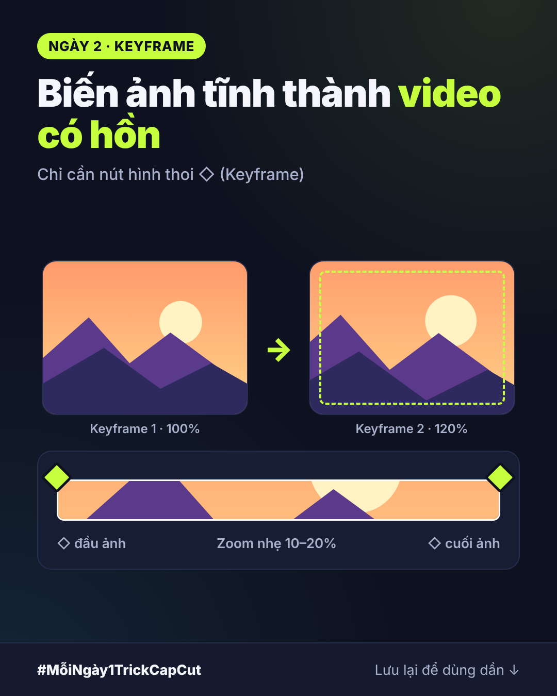

Có 10 tấm ảnh du lịch, ghép lại thì trông như… slide PowerPoint? 😶

Bí mật nằm ở nút **hình thoi ◇ (Keyframe)**, thứ giúp ảnh tĩnh “chuyển động” như trong phim tài liệu.

Cách làm:
1️⃣ Chọn ảnh trên dòng thời gian, kéo vạch trắng về **đầu** ảnh → bấm ◇
2️⃣ Kéo vạch trắng về **cuối** ảnh → dùng 2 ngón tay phóng to ảnh lên khoảng 110–120%. CapCut tự tạo keyframe thứ hai.
3️⃣ Bấm Play: ảnh từ từ zoom vào, mượt như máy quay đang tiến lại gần 🎥

Nâng cấp thêm:
🔹 Đổi hướng xen kẽ: ảnh 1 zoom vào, ảnh 2 zoom ra, ảnh 3 trượt ngang
🔹 Zoom nhẹ thôi (10–20%). Zoom mạnh dễ chóng mặt và vỡ ảnh.
🔹 Kết hợp với nhạc nhẹ, nhìn giống hẳn phim kỷ niệm

Kỹ thuật này có tên **hiệu ứng Ken Burns**, đã được dùng trong phim tài liệu hàng chục năm nay.

Cuối tuần rồi, lôi ảnh cũ ra làm thử đi! Làm xong khoe thành quả dưới comment nhé 👇

📌 Lưu lại để dùng dần.
#MỗiNgày1TrickCapCut #CapCut #Keyframe #EditVideo

---

### Bài 4 · 20:00 · Tranh luận: Edit bằng điện thoại hay máy tính?
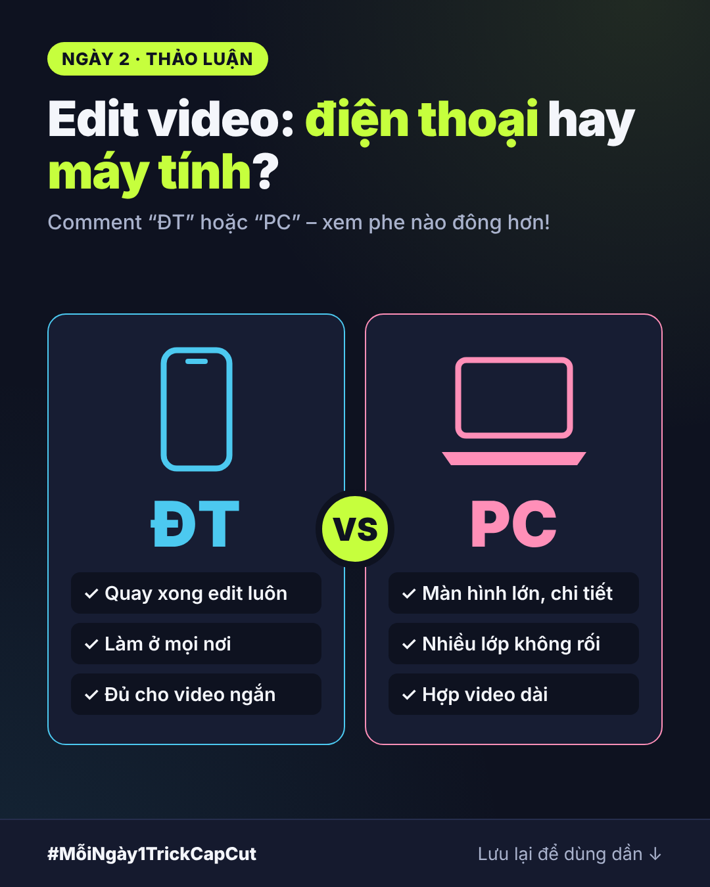

Câu hỏi gây tranh cãi nhất giới edit video 👇

📱 **PHE ĐIỆN THOẠI**
• Quay xong edit luôn, đăng trong 15 phút
• Tiện: ngồi quán cà phê, trên xe cũng làm được
• Đủ cho phần lớn video ngắn: Reels, TikTok, Shorts

💻 **PHE MÁY TÍNH**
• Màn hình lớn, nhìn chi tiết, chỉnh từng khung hình
• Nhiều lớp video, âm thanh cùng lúc mà không rối
• Hợp với video dài, chỉnh màu và âm thanh kỹ

Góc nhìn của mình: **công cụ không quan trọng bằng tư duy kể chuyện.** Rất nhiều video triệu view được edit hoàn toàn trên điện thoại. Cũng có video dựng công phu trên máy tính mà không ai xem hết.

Chọn cái giúp bạn **làm đều đặn** nhất. Đăng đều quan trọng hơn đăng hoàn hảo.

Còn bạn đứng về phe nào? Comment **“ĐT”** hoặc **“PC”**. Tối mai mình tổng kết xem phe nào đông hơn 🔥

#MỗiNgày1TrickCapCut #CapCut #EditVideo #ĐTHayPC

---

## NGÀY 3 – Thứ 2, 19/10

### Bài 5 · 11:30 · Cắt video khớp nhạc tự động
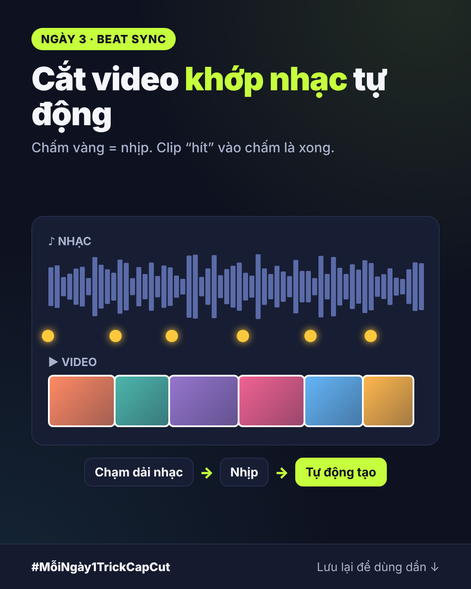

Từng xem mấy video mà mỗi cảnh “bùm” đúng nhịp nhạc và nghĩ chắc phải dân chuyên mới làm được? 🎶

CapCut làm được trong 2 phút:

1️⃣ Thêm nhạc vào dự án → chạm vào dải nhạc
2️⃣ Chọn **Nhịp (Beats)** → bật **Tự động tạo (Auto generate)**
3️⃣ Các **chấm vàng** xuất hiện đúng nhịp của bài hát
4️⃣ Kéo cạnh từng clip, clip sẽ tự “hít” vào chấm vàng gần nhất. Xong!

Mẹo để video cuốn hơn:
🔸 Cảnh mạnh nhất (nhảy, xoay, cười to) đặt đúng đoạn nhạc cao trào
🔸 Không cần cắt ở MỌI nhịp: cắt cách 1–2 nhịp sẽ đỡ rối mắt
🔸 Đầu bài cắt chậm, càng về sau cắt nhanh dần để tạo cảm giác tăng tốc

Thử ngay với clip đi chơi cuối tuần vừa rồi đi, nhìn khác hẳn đấy!

🎁 Gợi ý nhỏ: tối nay mình sẽ ghép trick này với trick hôm qua để làm một video rất đặc biệt cho ngày mai. Đoán thử là gì? 😉

📌 Lưu lại để dùng dần.
#MỗiNgày1TrickCapCut #CapCut #BeatSync #EditVideo

---

### Bài 6 · 20:00 · Video tặng 20/10 trong 10 phút
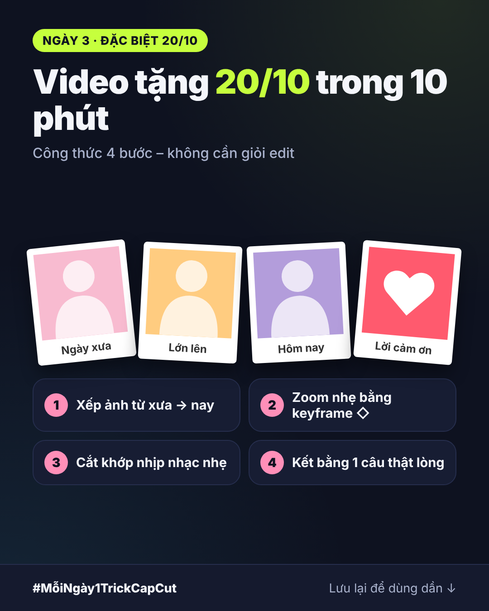

Còn chưa đến 24 giờ nữa là 20/10 💐 Quà chưa kịp mua? Một video tự tay làm có khi còn khiến mẹ, vợ, người yêu xúc động hơn.

Công thức 10 phút, chỉ dùng những trick đã học trong tuần:

1️⃣ **Chọn 8–15 ảnh/clip**, xếp theo thời gian từ ngày xưa đến bây giờ. Video biết kể chuyện sẽ chạm hơn video chỉ ghép ảnh.
2️⃣ **Zoom nhẹ từng ảnh** bằng keyframe ◇ (bài sáng CN)
3️⃣ **Cắt khớp nhịp** một bản nhạc nhẹ nhàng (bài sáng nay)
4️⃣ **Kết bằng MỘT câu thật lòng** thay vì lời chúc chung chung. Ví dụ: “Cảm ơn mẹ vì 25 năm chưa bao giờ để con đói bữa nào.”

Mẹo nhỏ:
💡 Thêm 1 tấm ảnh “dìm hàng” hài hước ở giữa, vừa cười vừa khóc mới là đỉnh 😂
💡 Gửi trước 0h, hoặc đăng lên trang cá nhân rồi tag người ấy vào

Bạn định làm video tặng ai? Tag người đó vào đây… hoặc giữ bí mật cũng được 🤫

📌 Lưu lại để làm ngay tối nay.
#MỗiNgày1TrickCapCut #CapCut #2010 #QuàTặng2010

---

## NGÀY 4 – Thứ 3, 20/10

### Bài 7 · 09:00 · Lời chúc 20/10 hiện từng chữ
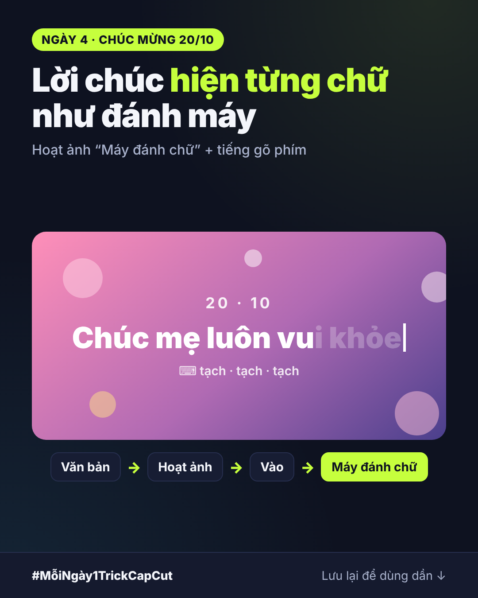

💐 Chúc mừng ngày Phụ nữ Việt Nam 20/10! Chúc tất cả phụ nữ luôn xinh đẹp, bình an và được yêu thương mỗi ngày.

Tặng bạn một trick nhỏ để lời chúc trong video “có hồn” hơn: **chữ hiện ra từng ký tự như đang được gõ.**

1️⃣ Chạm **Văn bản → Thêm chữ**, gõ lời chúc
2️⃣ Chọn **Hoạt ảnh (Animation) → Vào (In) → Máy đánh chữ (Typewriter)**
3️⃣ Kéo thanh thời lượng hoạt ảnh dài ra để chữ hiện chậm, có cảm xúc hơn
4️⃣ Vào **Âm thanh → Hiệu ứng âm thanh**, tìm “typing” hoặc “keyboard” để thêm tiếng gõ phím ⌨️

Mẹo:
✨ Font chữ viết tay hợp với lời chúc tình cảm
✨ Đặt chữ trên nền ảnh hơi mờ để chữ nổi bật
✨ Lời chúc ngắn gọn, 1–2 câu là đủ chạm

Giờ đến lượt bạn: viết lời chúc 20/10 của bạn dưới comment nhé. Biết đâu người ấy đang đọc 😉

📌 Lưu lại, ngày lễ nào cũng dùng được.
#MỗiNgày1TrickCapCut #CapCut #2010 #PhụNữViệtNam

---

### Bài 8 · 20:00 · Phân thân: 2 bạn trong 1 khung hình
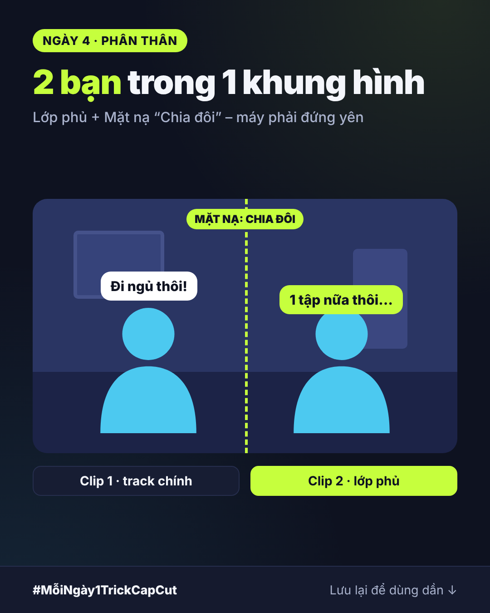

Bạn đã từng thấy video một người tự cãi nhau với… chính mình chưa? 🤯 Trông như kỹ xảo phim, nhưng CapCut làm được trong 5 phút.

**Chuẩn bị:** điện thoại đặt CỐ ĐỊNH (dùng chân máy hoặc kê lên chồng sách)

1️⃣ Quay clip 1: bạn đứng bên **trái** khung hình
2️⃣ Không chạm vào máy, quay clip 2: bạn đứng bên **phải**
3️⃣ Đưa clip 1 vào dòng thời gian chính, clip 2 thêm vào bằng **Lớp phủ (Overlay)**, phóng to cho khớp toàn khung
4️⃣ Chọn lớp phủ → **Mặt nạ (Mask) → Chia đôi (Split)** → kéo đường chia vào giữa “hai bạn”, tăng làm mờ viền một chút

Thế là có 2 bạn trong 1 khung hình! 👯

Mẹo để không lộ:
🔸 Khóa lấy nét và độ sáng trên điện thoại (giữ ngón tay vào màn hình khi quay)
🔸 Quay 2 clip liền nhau để ánh sáng không đổi
🔸 Không bước qua đường chia giữa

Ý tưởng: “Tôi lúc 6h sáng vs tôi lúc 11h đêm”, “Tôi đi làm vs tôi đi chơi”…

Làm thử rồi khoe mình xem nào 👇
#MỗiNgày1TrickCapCut #CapCut #PhânThân #EditVideo

---

## NGÀY 5 – Thứ 4, 21/10

### Bài 9 · 11:30 · Slow-motion “sang chảnh” bằng đường cong tốc độ
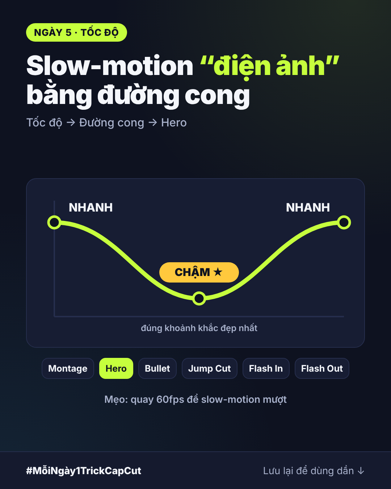

Vì sao cùng một clip mà người khác edit lại “điện ảnh” hơn hẳn? Rất có thể họ dùng **Đường cong tốc độ**.

Thay vì cả clip chậm đều, video sẽ: **nhanh → CHẬM đúng khoảnh khắc đẹp nhất → nhanh trở lại.**

Cách làm:
1️⃣ Chọn clip → **Tốc độ (Speed) → Đường cong (Curve)**
2️⃣ Chọn mẫu có sẵn:
• **Hero**: nhanh – chậm – nhanh, hợp với khoảnh khắc “đỉnh”
• **Montage**: nhịp dồn dập, hợp clip du lịch
• **Bullet**: chậm sâu ở giữa như phim hành động
• **Flash In / Flash Out**: tăng/giảm tốc ở đầu hoặc cuối clip
3️⃣ Chạm **Chỉnh sửa** để kéo đoạn chậm vào đúng khoảnh khắc bạn muốn

Mẹo:
💡 Quay ở **60fps** để slow-motion mượt, không giật
💡 Hợp nhất với: tóc bay, hất nước, nhảy lên, quay người
💡 Mỗi video chỉ nên có 1–2 đoạn chậm, nhiều quá sẽ mất tác dụng

Bạn sẽ thử với cảnh nào? Comment cho mình biết nhé 👇

📌 Lưu lại để dùng dần.
#MỗiNgày1TrickCapCut #CapCut #SlowMotion #EditVideo

---

### Bài 10 · 20:00 · Sự thật: video viral không cần máy quay xịn
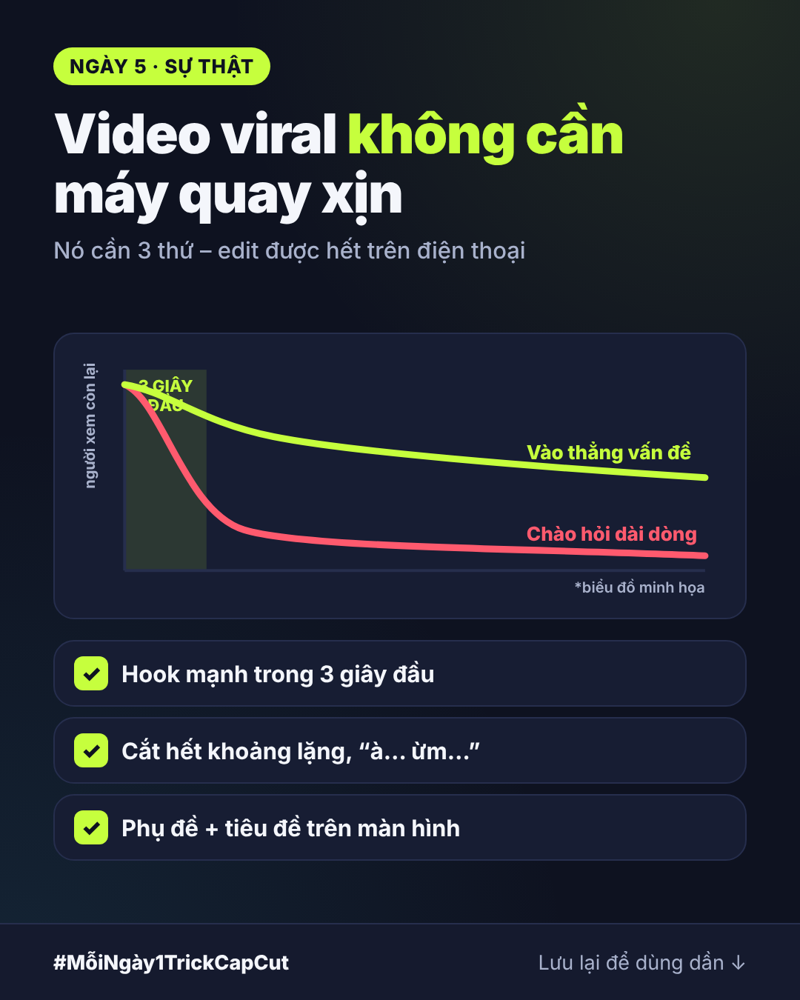

“Phải có máy quay xịn, đèn xịn thì video mới nhiều view.”
Nghe quen không? Đó là một **hiểu lầm**. 🙅

Rất nhiều video lan truyền mạnh được quay bằng điện thoại bình thường. Chúng thắng nhờ 3 thứ, và cả 3 đều **edit được trên CapCut**:

🎯 **1. 3 giây đầu**
Cắt bỏ màn chào hỏi “Xin chào mọi người, hôm nay mình sẽ…”. Vào thẳng điều hấp dẫn nhất, hoặc mở bằng một câu hỏi khiến người xem phải tò mò.

✂️ **2. Nhịp nhanh, không khoảng lặng**
Dùng **Tách (Split)** để cắt hết những đoạn “à… ừm…”, ngập ngừng, im lặng. Video ngắn đi 20% nhưng cuốn hơn gấp nhiều lần.

🔤 **3. Phụ đề + tiêu đề trên màn hình**
Người xem tắt tiếng vẫn hiểu, người lướt nhanh vẫn biết video nói về gì (xem lại trick ngày 1).

Thiết bị giúp video **đẹp hơn**.
Cách edit giúp video **được xem hết**.

Bạn đồng ý hay phản đối? Comment lý do, mình muốn nghe góc nhìn của bạn 👇

#MỗiNgày1TrickCapCut #CapCut #VideoViral #SángTạoNộiDung

---

## NGÀY 6 – Thứ 5, 22/10

### Bài 11 · 11:30 · Xóa phông không cần phông xanh
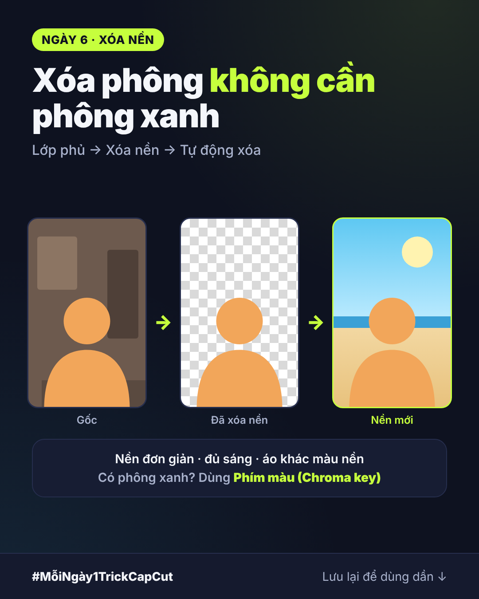

Muốn “đứng” trước tháp Eiffel trong khi đang ở phòng trọ? 😎 Không cần phông xanh, CapCut có thể tự tách người khỏi nền.

1️⃣ Thêm ảnh/video **nền mới** vào dòng thời gian chính
2️⃣ Thêm clip quay bạn bằng **Lớp phủ (Overlay)**
3️⃣ Chọn lớp phủ → **Xóa nền (Remove background) → Tự động xóa**
4️⃣ Chỉnh vị trí, kích thước cho tự nhiên. Xong!

Để viền tách sạch, không bị “nhòe tóc”:
✅ Đứng trước nền đơn giản, ít đồ vật
✅ Đủ ánh sáng, tốt nhất là ánh sáng chiếu từ phía trước
✅ Mặc đồ khác màu với nền phía sau

Có phông xanh rồi? Dùng **Phím màu (Chroma key)** trong mục Xóa nền → chọn màu xanh → tăng cường độ. Kết quả còn sạch hơn nữa.

Ý tưởng dùng ngay:
🔹 Thuyết trình đứng trước slide
🔹 Review đứng trước sản phẩm, địa điểm
🔹 “Du lịch vòng quanh thế giới” mà không cần ra khỏi nhà 🌍

📌 Lưu lại để dùng dần.
#MỗiNgày1TrickCapCut #CapCut #XóaPhông #EditVideo

---

### Bài 12 · 20:00 · Dừng hình giới thiệu nhân vật (đón Halloween)
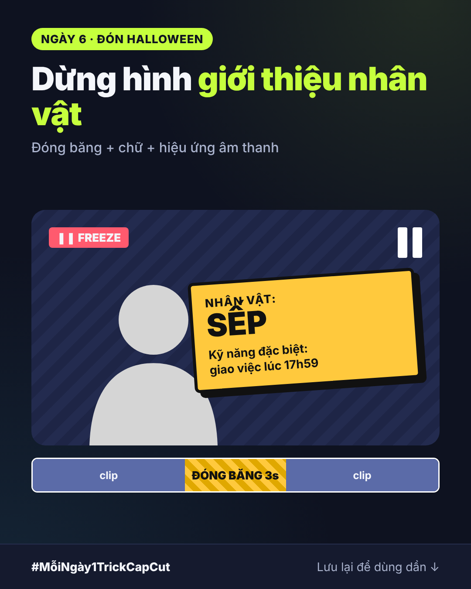

Đang chạy thì **DỪNG HÌNH**, hiện tên kèm “kỹ năng đặc biệt” như phim hoạt hình 😂 Kiểu video này lần nào cũng khiến cả nhóm bạn tag nhau ầm ầm.

Cách làm với CapCut:
1️⃣ Kéo vạch trắng đến khoảnh khắc **biểu cảm nhất** (nhăn mặt, há miệng, đang cười…)
2️⃣ Chọn clip → **Đóng băng (Freeze)**: CapCut tạo đoạn ảnh tĩnh khoảng 3 giây
3️⃣ Thêm **Văn bản**: tên nhân vật + mô tả hài hước
4️⃣ Thêm **Hiệu ứng** zoom/rung nhẹ và hiệu ứng âm thanh kiểu “record scratch” hoặc tiếng chụp ảnh 📸

Ví dụ:
🧑‍💼 *Nhân vật: Sếp. Kỹ năng đặc biệt: giao việc lúc 17h59*
👩‍💻 *Nhân vật: Kế toán. Điểm yếu: ngày 25 hằng tháng*

🎃 Halloween sắp tới rồi, đây là format hoàn hảo để giới thiệu “dàn nhân vật” hóa trang của nhóm bạn!

Nếu làm video về team mình, bạn sẽ ghi “kỹ năng đặc biệt” của bản thân là gì? Comment đi, mình đọc hết 😆

📌 Lưu lại để dùng dần.
#MỗiNgày1TrickCapCut #CapCut #Halloween #EditVideo

---

## NGÀY 7 – Thứ 6, 23/10

### Bài 13 · 11:30 · Âm thanh sạch
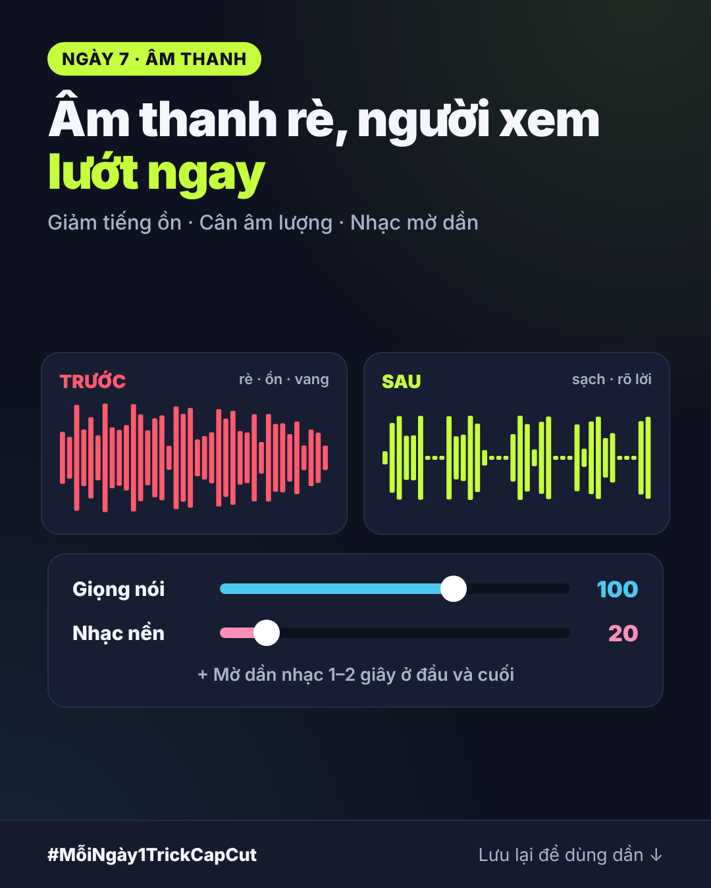

Người xem có thể bỏ qua hình hơi mờ, nhưng **hiếm ai chịu nổi tiếng rè, tiếng gió hay nhạc to át giọng.** Âm thanh thường là thứ khiến người xem lướt đi nhanh nhất 🎧

4 bước để âm thanh “sạch” trên CapCut:

1️⃣ **Giảm tiếng ồn**: chọn clip → tìm **Giảm tiếng ồn (Reduce noise)** → bật. Tiếng quạt, tiếng xe nhỏ đi rõ rệt.
2️⃣ **Cân âm lượng**: giọng nói khoảng 100 hoặc cao hơn, nhạc nền khoảng 15–30
3️⃣ **Nhạc lên xuống theo lời nói**: dùng keyframe ◇ trên dải nhạc. Không có lời thì nhạc to, có lời thì nhạc nhỏ.
4️⃣ **Mờ dần (Fade)**: cho nhạc vào và kết thúc trong 1–2 giây, đừng tắt cái “phụt”

Mẹo thu âm (quan trọng hơn cả edit):
💡 Để điện thoại gần miệng, cách khoảng một gang tay
💡 Thu trong phòng có rèm, chăn, gối để bớt tiếng vang
💡 Tránh quay ngoài trời lúc gió to

Âm thanh tốt thì người xem ở lại. Âm thanh tệ thì họ lướt ngay.

📌 Lưu lại để dùng dần.
#MỗiNgày1TrickCapCut #CapCut #ÂmThanh #EditVideo

---

### Bài 14 · 20:00 · Tổng kết 7 ngày + thử thách
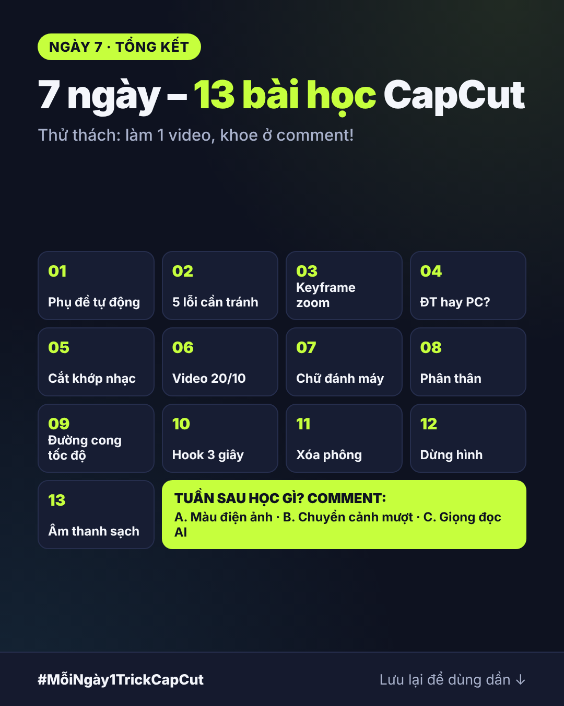

7 ngày, 13 bài học CapCut 🎬 Bạn đã thử được mấy cái?

1. Phụ đề tự động
2. 5 lỗi “làm vội” cần tránh
3. Keyframe zoom ảnh tĩnh
4. Điện thoại hay máy tính?
5. Cắt khớp nhịp nhạc
6. Video tặng 20/10 trong 10 phút
7. Chữ hiện như đánh máy
8. Phân thân 2 người
9. Slow-motion bằng đường cong tốc độ
10. Hook 3 giây đầu
11. Xóa phông không cần phông xanh
12. Dừng hình giới thiệu nhân vật
13. Âm thanh sạch

🔥 **THỬ THÁCH CUỐI TUẦN**
Chọn 1 trick bất kỳ ở trên, làm 1 video, rồi đăng link hoặc video dưới bài này kèm **số thứ tự của trick**. Mình sẽ xem và góp ý từng video 💬

🗳️ **Tuần sau bạn muốn học gì?** Comment chữ cái:
**A.** Chỉnh màu như phim điện ảnh
**B.** Chuyển cảnh mượt không lộ
**C.** Văn bản thành giọng đọc AI

Cảm ơn bạn đã theo dõi suốt tuần qua ❤️ Chia sẻ bài này cho người bạn đang tập edit video nhé!

#MỗiNgày1TrickCapCut #CapCut #EditVideo #ThửTháchCapCut

---

## Đăng tự động lên Fanpage

Script: `scripts/post-to-facebook.cjs` (dùng Facebook Graph API chính thức, đăng ảnh kèm nội dung, hẹn đúng giờ Việt Nam).

**Lấy Page Access Token (làm 1 lần):**
1. Vào https://developers.facebook.com → **My Apps → Create App** → loại **Business**.
2. Mở **Tools → Graph API Explorer**, chọn app vừa tạo → **Get Page Access Token**, cấp quyền `pages_show_list`, `pages_manage_posts`, `pages_read_engagement`.
3. Ở ô “User or Page”, chọn Fanpage → copy token (đây là Page Token).
4. Đổi sang token dài hạn bằng **Access Token Debugger → Extend Access Token** (token ngắn hạn hết hạn sau khoảng 1 giờ).
5. Lưu token vào biến môi trường `FB_PAGE_TOKEN`. **Không dán token vào chat hay commit vào repo.**

**Chạy:**
```bash
node facebook-capcut-7-ngay/scripts/post-to-facebook.cjs              # xem trước
node facebook-capcut-7-ngay/scripts/post-to-facebook.cjs --check      # kiểm tra token đúng Fanpage
node facebook-capcut-7-ngay/scripts/post-to-facebook.cjs --schedule   # hẹn giờ cả 14 bài
node facebook-capcut-7-ngay/scripts/post-to-facebook.cjs --now 1      # đăng ngay bài 1
```
Sau khi hẹn giờ, bài nằm trong **Meta Business Suite → Nội dung → Đã lên lịch**, có thể sửa hoặc xóa ở đó.
